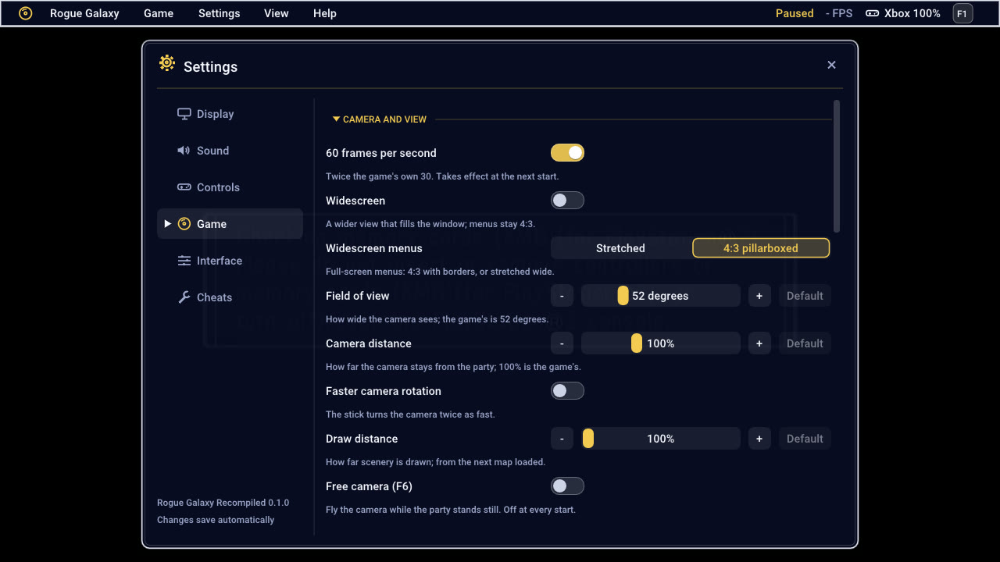

# Rogue Galaxy Recompiled

**Rogue Galaxy** (Level-5 / SCE, PlayStation 2) as a native Windows game: a
static recompilation of the USA release (SCUS-97490), built on
[PS2Recomp](https://github.com/ran-j/PS2Recomp). You build it from your own
disc image; nothing of the game is distributed.

> **No game data is included, and this project is not affiliated with, or
> endorsed by, Level-5, Sony or any other rights holder.** "Rogue Galaxy" and
> everything in the game belong to them. This repository holds source code,
> tools and documentation only: no disc image, no BIOS, no extracted file, no
> texture pack, no movie. You need your own copy of the game, and everything
> made from it (the extracted disc, the HD textures, the HD movies) stays on
> your PC; see [docs/SHARING.md](docs/SHARING.md).

  
  

- 60 fps, or the original 30
- Widescreen, up to 32:9, with the menus kept at 4:3
- Up to 8x internal resolution (or Auto, from the window's height), with
  FSR or a supersampled downscale
  ([GRAPHICS-UPSCALING.md](docs/GRAPHICS-UPSCALING.md); ReShade can be let in)
- An in-game menu (F1) for graphics, sound and controls
- Xbox button prompts (in the help pictures and controller drawings too), a
  sharp modern font (menu and battle numbers included), and texture packs
  ([FONT-AND-PROMPTS.md](docs/FONT-AND-PROMPTS.md)), including 4x HD
  textures built from your disc ([TEXTURE-PACKS.md](docs/TEXTURE-PACKS.md))
- HD cutscenes: the 89 movies play from 1080p upscales you build from your
  disc, with the game's own sound and timing, and fall back to the original
  movie wherever there is no file ([HD-MOVIES.md](docs/HD-MOVIES.md))
- Game options: camera, field of view, draw distance, instant text,
  encounter rate, experience, money, item drops, shop prices and more
  ([all of them](docs/OPTIONS.md))
- Cheats, behind a master switch (F5) that is off at every start and blocks
  saving while it is on: infinite HP and AP, a full action gauge, one-hit
  kills, items that are not used up, money held or maxed
  ([CHEATS.md](docs/CHEATS.md))

## Install (Windows)

You need Windows 10 or 11 (64-bit), about 18 GB free, an internet connection (only for the HD parts)
and your own image of the disc: Rogue Galaxy, USA, SCUS-97490
([`docs/DISC.md`](docs/DISC.md)).

1. Download `RogueGalaxy-Setup-<version>-<commit>-windows.zip` from the
   [releases](../../releases) page (not "Source code") and unpack the whole
   thing to a short folder with room to spare, such as `C:\RogueGalaxy`
   (about 18 GB for the game, 40 GB or more with the HD parts).
2. Double-click **`RogueGalaxy-Setup.exe`**. Windows may warn that it comes
   from an unknown publisher, because the program is not code-signed: choose
   "More info", then "Run anyway", if you trust where you got it.
3. Choose your disc image (an `.iso`, `.bin`/`.cue`, `.chd`, or a folder with
   the disc's files; you can drop it on the window) and what to install:
   **Faithful** (the game only), **Recommended** (the game, HD textures, the
   modern font with Xbox prompts) or **Everything** (also the HD movies), or
   pick the parts one by one, each with its disk space and time. The window
   lists every file it would download, with its address, size, SHA-256 and
   licence, and waits for your yes; the game itself needs no download, the
   build tools are in the zip. Building the game takes about 20 to 25 minutes
   on a fast PC (the author's: Ryzen 9 7900X, RTX 5070 Ti), up to an hour on
   a slower one; the HD parts add more, as the window says. You can use the
   PC meanwhile, and **Cancel** keeps what is finished.
4. Press **Play**, or later double-click `Rogue Galaxy.exe`. To add the HD
   parts later, or to update, run `RogueGalaxy-Setup.exe` again (F1 > Setup
   and HD in the game opens it too); to update, unpack the newer zip over the
   folder first. Nothing is installed in Windows; to uninstall, delete the
   folder (your saves are in `disc\mc0`).

The window is a front end over the setup program, `python -m rgsetup`
([docs/INSTALLER.md](docs/INSTALLER.md)), which also runs without it
(`Setup-Console.cmd` in the zip). In a source checkout, `Install.bat` and
`Build-HD-Pack.bat` do the same after downloading the build tools (about 300
MB); a source zip or checkout is for developers, players want the release.

### HD textures and HD movies (optional)

After `Install.bat`, double-click **`Build-HD-Pack.bat`**. It builds, from your
own disc, the 4x AI-upscaled texture pack and the 89 upscaled 1080p cutscenes
and puts them where the game looks for them: choose **[1] textures**, **[2]
movies** or **[3] both**. It shows what it will do, the disk space and the
time first (on the author's RTX 5070 Ti: textures about 20 to 30 minutes, the
movies about 1.5 hours; a weaker graphics card takes several times longer),
needs a Vulkan graphics card (NVIDIA, AMD or Intel Arc) and about 11 GB for
each, asks before it downloads anything (Real-ESRGAN, 45 MB; FFmpeg, 110 MB,
only if you have none), can be stopped and run again where it left off, and
has a `--gentle` mode that keeps the PC usable. Details, options and
troubleshooting: [docs/HD-BUILD.md](docs/HD-BUILD.md).

If it stops, `install.log` (and `work\setup\logs`) says why; running `Install.bat` again continues
where it stopped. If an antivirus removes the compiler, restore it and run
it again. To uninstall, delete the folder (your saves are in `disc\mc0`).

## Controls

The game window takes a keyboard or a gamepad (PlayStation layout).

| Pad | Keyboard |
|---|---|
| Left stick | W A S D |
| D-pad | Arrow keys |
| ✕ / ○ / □ / △ | X or Space / C or Esc / Z / V |
| L1 / R1 / L2 / R2 | Q / E / Left Shift / Right Shift |
| Start / Select | Enter / Tab |
| Right stick | I J K L |
| R2 held: fast-forward | ` held (left of 1) |
| L2: fast-forward on or off | F4 |

**F1** (or the Guide button, or Back+Start) opens the menu: Display, Sound,
Controls, Game (the options above, in sections), Interface and Cheats; every page has
a Restore defaults button, and the things few players touch are in a folded
Advanced group. F11 or Alt+Enter
toggles fullscreen, F12 takes a screenshot, F5 the cheats master switch. While L2 and R2 run
fast-forward, the game does not get them (F1 > Interface turns that off;
the speed is chosen there too, from 1.5x to 8x or Max). The options are also on the
game's own Settings screen (System > Settings, L1 and R1 to turn the page).
See [docs/OPTIONS.md](docs/OPTIONS.md) for each one, and
[docs/MENU-DESIGN.md](docs/MENU-DESIGN.md) for how the menu is laid out.

## More

- [CHANGELOG.md](CHANGELOG.md): what each release brings, and its known issues
- [docs/INSTALLER.md](docs/INSTALLER.md): the setup program behind `Install.bat` and
  `Build-HD-Pack.bat`: presets, disc inputs, options, events, resuming and updating
- [docs/OPTIONS.md](docs/OPTIONS.md): the menu and every game option
- [docs/CHEATS.md](docs/CHEATS.md): the cheats: what each does, where it lives
  in the game, what was verified, and why saving is blocked while they are on
- [docs/FONT-AND-PROMPTS.md](docs/FONT-AND-PROMPTS.md): button prompts, the
  modern font, texture replacement packs
- [docs/HD-BUILD.md](docs/HD-BUILD.md): `Build-HD-Pack.bat`: the one-click
  HD textures and movies builder, its options, steps, and what to do when it
  stops
- [docs/TEXTURE-PACKS.md](docs/TEXTURE-PACKS.md): HD texture packs: how they
  work, tuning, learn mode
- [docs/HD-MOVIES.md](docs/HD-MOVIES.md): HD cutscenes: the folder, the file
  layout, how they play and fall back
- [docs/SHARING.md](docs/SHARING.md): what may and may not be shared (code and
  tools yes; texture packs, movies, extracted data no)
- [THIRD-PARTY-NOTICES.md](THIRD-PARTY-NOTICES.md): the licences of everything
  this builds on
- [docs/BUILDING.md](docs/BUILDING.md): building by hand, and the project's layout
- [docs/DEVELOPMENT.md](docs/DEVELOPMENT.md): the debug launchers, profiling and
  the environment variables
- [docs/STATUS.md](docs/STATUS.md): how the work went, and what the game needs

## Legal

You must own the game. No game data, BIOS or disc-derived files are part of
this repository: `disc/`, disc images, `textures/` (the HD packs), `work/`
(what the HD builder makes) and `toolchain/` are gitignored and must never be
committed or shared ([docs/SHARING.md](docs/SHARING.md)). This is an
independent fan project, not affiliated with, authorised or endorsed by
Level-5, Sony Computer Entertainment or Sony Interactive Entertainment.

## FAQ

**Is the game included?** No. You build it from your own disc image
(`Install.bat`); nothing of the game is in this repository or its releases.

**Can I download the HD texture pack or the HD movies?** No, and nobody can
offer them: they are the game's own pictures and movies, scaled up, so sharing
them is sharing the game. `Build-HD-Pack.bat` makes them on your PC from your
disc ([docs/SHARING.md](docs/SHARING.md) says why).

**Which disc works?** The USA release, SCUS-97490, the Redump image of
6,967,721,984 bytes ([docs/DISC.md](docs/DISC.md)). The setup checks the
serial, the sizes and the hashes of the files whatever the format you give it
(ISO, BIN/CUE, CHD, or an extracted folder), and says plainly what it found if
it is another release or an incomplete dump.

**Do I need a good graphics card?** To play, any recent Vulkan card. To *build*
the HD pack you need an NVIDIA, AMD or Intel Arc card with a current driver: the
upscaler runs on it. On the author's RTX 5070 Ti the textures take about 20 to 30
minutes and the movies about 1.5 hours.

**It says "no usable Vulkan graphics card".** Update the graphics driver. On a
laptop with two chips make Windows use the faster one for the builder
(Settings > System > Display > Graphics), or pass `--gpu N`. Without a card
the game still plays; it just has no HD pack.

**The builder stopped or I closed the window.** Run `Build-HD-Pack.bat` again:
finished steps and finished movies are skipped. The log is
`work\hd\build.log`; docs/HD-BUILD.md lists what each message means.

**Can I use the PC while it builds?** Yes with `Build-HD-Pack.bat --gentle`
(lowest priority, one upscaler thread set). It is slower.

**Is the HD pack the same for everyone?** Yes: the models, the classes and the
steps are fixed, so the same disc gives the same pictures (the AI model's
output can differ in the last bit between graphics cards and drivers).

**Where do the files go, and how do I get rid of them?** The pack:
`textures\SCUS-97490\replacements`; movies: `textures\SCUS-97490\movies`; the
builder's work files: `work\hd` (about 20 GB; the builder offers to delete them
when it finishes). Delete the folders to go back to the original look.

**Is it safe to download the tools it asks for?** It shows each address and
SHA-256 first, asks, and refuses a file that does not match. Real-ESRGAN and
FFmpeg are put in `toolchain\` and not installed in Windows.

**Can I publish a fork?** Yes: the code is GPL-3.0. Do not commit anything from
`disc\`, `textures\` or `work\`. [docs/SHARING.md](docs/SHARING.md) has a
checklist, and [THIRD-PARTY-NOTICES.md](THIRD-PARTY-NOTICES.md) the licences.

## Credits

- [PS2Recomp](https://github.com/ran-j/PS2Recomp) by ran-j, and the
  [fork](https://github.com/Sinan-Karakaya/PS2Recomp) by Sinan Karakaya.
- [DQ8-Recompiled](https://github.com/Sinan-Karakaya/DQ8-Recompiled) by Sinan
  Karakaya, the reference for MWo3 overlays on PS2Recomp, and the source of
  the SDL3 GPU GS backend and the in-game menu in `thirdparty/dq8-gfx`.
- [Dear ImGui](https://github.com/ocornut/imgui) by Omar Cornut (MIT), which
  the menu is drawn with, and its Roboto Medium font (Apache 2.0), also the
  modern in-game font, rasterised with Dear ImGui's copy of
  [stb_truetype](https://github.com/nothings/stb) (public domain / MIT).
- [Real-ESRGAN](https://github.com/xinntao/Real-ESRGAN) (BSD-3-Clause) and its
  ncnn-vulkan build, which the HD builder downloads on request to upscale the
  pictures and movies, and [FFmpeg](https://ffmpeg.org) for the movies.
- [RGDecomp](https://github.com/Dorgengoa/RGDecomp) (CC0), the function maps
  and names for this build (`config/SCUS_974.90/functions_*.csv` derive from
  it).
- [Redump](http://redump.org/disc/6567/) and [PCSX2](https://github.com/PCSX2/pcsx2)
  (GameDB, patches) for disc and hardware notes.

The full list with licences is in [THIRD-PARTY-NOTICES.md](THIRD-PARTY-NOTICES.md).

## License

GPL-3.0, the same as PS2Recomp, which the built executable links. See
[`LICENSE`](LICENSE).
