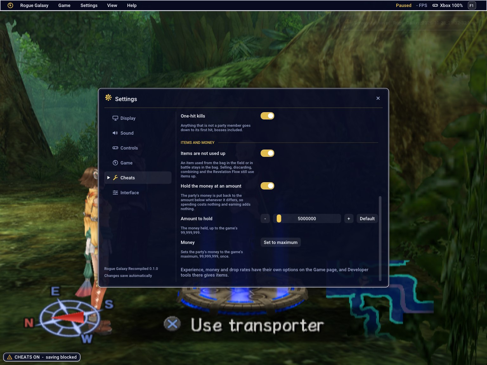

# Cheats

F1 > Settings > **Cheats** (the Game menu's **Cheats** entry and **F5**
switch the master). Trainer-style helpers: each one is a native hook or a
per-frame write into the game's memory, the way the other options work, found
in the game's code and checked in the running game. Nothing replays a
PCSX2 code.

## How it works, and what keeps your saves safe

- **Master switch.** Nothing acts until it is on. **F5** toggles it from the
  keyboard (also under Game > Cheats), the Cheats page has the same switch.
- **Off at every start.** The master switch is not kept in `settings.ini`:
  even a file with `cheats_master = 1` starts with it off. Which cheats are
  ticked (and the money amount) are kept, so one press of F5 brings your set
  back, and nothing is applied before you ask.
- **A notice the first time.** Turning the master on for the first time shows
  what cheats do and that saving is blocked; "Turn cheats on" is remembered
  (`cheats_notice_seen = 1` in settings.ini), "Not now" asks again next time.
- **The game cannot save while the master is on.** The save screen's step
  ends at once with the game's own failure ("Save to file 1 failed.") before
  any card call, and the memory card's write calls (open for writing, write,
  make folder, delete, rename, file info, format) fail as well, so a card is
  never touched. Loading is not blocked. Turn the master off (F5) to save.
  The card was checked byte for byte after an attempted save.
- **An indicator.** While the master is on a badge in the picture's lower left
  says "CHEATS ON - saving blocked" ("Cheats master on" with nothing ticked);
  F5 shows a toast each way, and a refused save shows one too.
- It is deliberately a blunt rule: the master on means no saving, even with
  only a harmless cheat ticked, so there is no state to reason about.

## The cheats

| Cheat | What it does | Verified |
|---|---|---|
| Infinite HP | The party takes no damage (a character's HP never goes down: `CharaSetHp` is where damage lands) and tops up to full each frame. Someone already down stays down. | Yes: in battle, damage to three characters was refused (log `damage refused: ... hp 167 would be 141`) and the HP and AP on the HUD stayed full |
| Infinite AP | Every character's AP is set to its maximum each frame. | Yes: AP held full in battle and in the menu |
| Full action gauge | The party's action gauge (a float, 1000 is full) is held full. | Yes: read 1000 for every character while on; it fluctuated (964, 832, 852) with it off |
| One-hit kills | Anything that is not a party member goes to 0 HP on its first hit, bosses included. | Yes: with it on all three enemies (300 to 320 HP) went to 0 within seconds of the first attacks; with it off a battle took many hits (HP dropped 305, 245, 83 ...) |
| Items are not used up | An item used from the bag in the field or in battle stays in the bag (the call from `ItemUseMaybe` is skipped; selling, discarding, combining and the Revelation Flow still use items up). | Yes: Heal Potion 21 -> 20 with it off, 20 -> 20 with it on (the potion did heal) |
| Hold the money at an amount | Whenever the party's money differs from the amount below, it is put back: spending costs nothing, earning adds nothing. Amount 0 to 99,999,999. | Yes: items screen showed 5,000,000 Z from 2,884 |
| Money: set to maximum | Once, the party's money becomes 99,999,999 (the game's own cap). | Yes: log `money 2994 -> 99999999` |

Experience, money and drop multipliers, the action gauge's speed and shop
prices already have options (Game > Battles and rewards); the main menu's
R3 item list is Game > Developer tools. They are not repeated here.

## Where the numbers live

Addresses are SCUS-97490's (USA). `GameData` is at `0x4B8B30` (`GetGameData`).

| What | Where | Source |
|---|---|---|
| The characters' pool | `GameData+0x14` is the manager, its pool (`manager+0x8`): base `+0x8`, stride `+0x10` (0x4C8), capacity `+0x14` (10), used-bit words `+0x20`. Records hold `+0xC` id (0 to 9), `+0x10` level (low 10 bits), `+0x14` HP, `+0x18` AP (u16), `+0x20` max HP, `+0x26` max AP (u16), `+0x1C4` action gauge (float), `+0x4B8` experience | Disassembly (`CharaGetHp` 0x200940, `CharaGetMp` 0x200920 are the AP, `CharaGetMaxHp` 0x200930, `CharaGetLevel` 0x29E070, `CharaGetExp` 0x29EA40, `UnitGetActionGauge` 0x2EF660); HUD, items and save screens read the same values |
| The enemies' pool | `GameData+0x1C` is the manager, its pool at `manager+0x10` (same layout; ids from 128, HP at +0x14, max +0x20, 300 to 320 in Juraika) | `ObjFindById` (0x3BB3A0), battle logs |
| Damage | `CharaSetHp(unit, hp)`, 0x3B8040: called for every change, from 0x3B8024 for a hit, characters and enemies alike | Logged: `hp 167 -> 141` on a party member, `300 -> 270` on an enemy |
| Money | `GameData+0x18` is the party; money is the 64-bit word at `+0x160`, capped by the int at 0x4659E0 (99,999,999) | `PartyAddMoney` (0x3C8E90); the items screen shows the value |
| Action gauge cap | The int at 0x465CD0 (1000) | `UnitGetActionGaugeMax` (0x2F10B0) |
| Item use | `ItemConsume` (0x3D41B0), from `ItemUseMaybe` (0x2EEF60) at the calls returning to 0x2EF080 and 0x2EF540 | Call graph; the item count in the bag |
| Per-frame hook | `GameFrameUpdate` (0x27C4C0) | Hit every frame |
| The save | `McSaveStep` (0x374110): a step a frame until it returns 1, the screen reads the half-word at `manager+0x4F0` (8 makes it say "Save to file N failed."; 0xC, which the step writes when it has no game data, makes it say "File N saved.", which is wrong here); and the libmc calls `sceMcOpen` 0x12CA58, `sceMcMkdir` 0x12CB80, `sceMcWrite` 0x12CF20, `sceMcFormat` 0x12D6C8, `sceMcDelete` 0x12D798, `sceMcSetFileInfo` 0x12D978, `sceMcRename` 0x12DB48, `sceMcUnformat` 0x12DCA0 | Disassembly; screenshots of both results; the card's files compared by checksum |

### What the web had

PCSX2 patch repositories and the cheat forums have next to nothing for
SCUS-97490: Almar's Guides lists NTSC-U CodeBreaker codes (unlimited item
usage, "Hunter Points", unlimited weapon 1 and 2 usage, max Z 0x05F5E0FF =
99,999,999, quick max EXP, bug tournament and feeding codes), but they are
encrypted (`2A...` lines) and were not decoded or replayed; an Almar example
pnach line for unlimited Z (`10222F70 0000270F`) falls in the game's code, not
data, so it was not used; a Cheat Engine table for the USA game (CRC
0643F90C) is sold on Ko-fi and was not obtained. The max Z agrees with the
money cap above, which was found independently. Everything shipped here comes
from the game's own code and was checked in the running game.

## Not shipped (not verified)

| Idea | What was found |
|---|---|
| Set the party's level / experience | The game's own "set level" is `CharaRecalcStatsFromLevel` (0x3AC5F0: zero the stats, add every level's row up to the level at +0x10, recompute, fill HP and AP), but called from a hook it found no rows and left a character at 0/0 HP; adding experience with `CharaAddExp` (0x3AC740) from a hook did not raise the level either. Calling the game's functions from a host hook needs more work (calls that end in a register jump, nested lookups), so it was left out rather than shipped broken. Use Game > Experience from battles for now. |
| Weapons that never run down | A weapon slot's charge is a float at `+0x10`, ticked every frame by `EquipSlotDrainGauge` (0x39FC20, amount 1.0) and cut by `EquipSlotDrainGaugeOnUse` (0x39FF00); in the battles tried every slot read 0.0 and no use of it was seen, so the effect could not be checked. The HUD's red weapon bar was not tied to it. |
| Walking speed, jump height | `CharaGetEffectiveSpeedScale` (0x213DD0) looks like a status speed (haste), not walking; not tried. |
| Unlock flags, items editor, Hunter Points, bug stats | Not looked at (the R3 item list, Game > Developer tools, gives items). |

## Test method

`build\game-dev\rg-cheats.exe`, the hidden window (`DQ8_GFX_HIDDEN_WINDOW=2`),
scratch settings, a copy of the memory card (File 01 of the repository's
card: Jaster, Kisala and Zegram in Juraika), `RG_INPUT` for the load,
`RG_INPUT_FILE` for the rest, `RG_FORCE_ENCOUNTER=1` for battles,
`RG_UI_SCRIPT` for the menu (`settings cheats`, `key F5`,
`cheatsnotice accept`, `scrollto cheat_money`). Test aids:

| Variable | Effect |
|---|---|
| `RG_CHEATS=hp,ap,gauge,items,onehit,money_hold` | The master on and these cheats for this run (not saved) |
| `RG_CHEATS_MONEY=N`, `RG_CHEATS_FIRE=max_money` | The held amount; the one-shot, once the game is up |
| `RG_CHEATS_LOG=1` | A line each 90 frames (money, each character's level, HP, AP, gauge, experience, each enemy's HP), and a line for each refused damage, item and save |
| `RG_CHEATS_CMD_FILE=path` | Lines read twice a second and emptied: `master 1`, `switch hp 1`, `number money 5000`, `fire max_money`, `hurt` (everyone to half HP) |

Screenshots: `research\assets\cheats\` beside the research notes.
