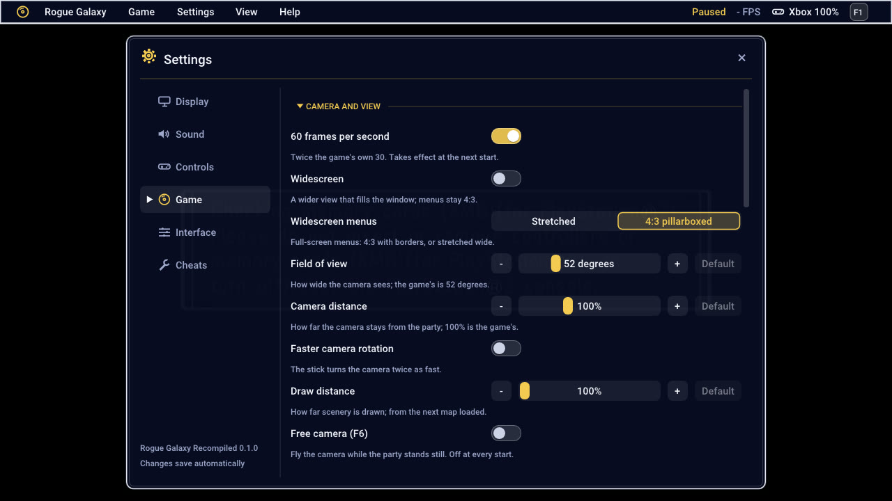

# Options

**F1** (or the Guide button, or Back+Start) opens the menu:

- **Display**: window or fullscreen, vertical sync, internal resolution
  (1x to 8x, or **Auto**: the scale that gives at least the window's height
  in lines, times an oversampling of 1.0, 1.25 or 1.5, capped at 2x-8x,
  default 6x; 1080 lines take 3x, 1440 take 4x, 2160 take 5x; it follows
  the window when resized, moved or made fullscreen, with a toast;
  `RG_GS_SCALE=auto` for one run; a very wide window costs more at the same
  height, so lower the cap on 32:9),
  aspect ratio, scaling filter (Sharp, Smooth, Nearest, **FSR**, AMD's
  edge-aware upscaling for a window larger than the internal resolution, or
  **Supersample**, a Lanczos average of every rendered pixel for an internal
  resolution larger than the window, 4x to 8x),
  **Sharpening** (AMD FSR 1's, off by default; see
  [GRAPHICS-UPSCALING.md](GRAPHICS-UPSCALING.md)), and **Borders**, what fills the sides of a
  4:3 picture (black, the picture blurred, or your own image from the
  `borders` folder).
- **Sound**: volume and muting.
- **Controls**: controller and keyboard remapping, dead zones.
- **Game**: the game options below.
- **Interface**: the menu's size, notifications, pause and fast-forward
  (its speed: 1.5x, 2x, 3x, 4x, 8x or Max, as fast as the PC goes; and
  whether L2 and R2 control it), the frame-rate counter.

| Key | Controller | |
|---|---|---|
| F2 | | Pause |
| F3 | | Frame-rate counter |
| F4 | L2 | Fast-forward on or off |
| ` (left of 1), held | R2, held | Fast-forward while held |
| F6 | | Free camera |
| F11 or Alt+Enter | | Fullscreen |
| F12 | | Screenshot |

## Fast-forward

The whole game runs faster: F4 or L2 switches it on and off, R2 or ` held
runs it only while held. The speed is set under Interface > Pause and speed,
or in the menu bar's Game > Fast-forward speed. Music and sounds keep their normal tempo
(the sound driver runs in step with the audio device), and movies play at
normal speed even with fast-forward on, so their sound stays with the
picture; it picks up again after the movie. It adds to the quick scenes
(Fast transporters, Fast Revelation Flow): 2x fast-forward in a quick scene
is 4x. How fast Max goes depends on the PC.

While "L2 and R2 control fast-forward" is on (it is by default), the game
no longer gets L2 and R2, and neither do the keys bound to them (Left and
Right Shift). Turn it off for anything in the game that needs them. The
free camera keeps them either way.

## Game options

**Camera and view**

| Option | |
|---|---|
| 60 frames per second | On by default; off, the game's own 30. From the next start. |
| Widescreen | A wider view that fills the window, from 4:3 to 32:9. Text over the field comes out stretched. |
| Widescreen menus | 4:3 pillarboxed (default): the full-screen menus (main menu, items, equipment, status, Settings, save and transporter menus, factory, insect and ship menus) are shown at 4:3 with Display > Borders beside them. Stretched: as wide as the window, as before. |
| Field of view | 40 to 90 degrees (the game's is 52). |
| Camera distance | 70% to 160% of the game's. |
| Faster camera rotation | The camera turns twice as fast. |
| Draw distance | 100% to 400% of the game's, from the next map loaded. |
| Free camera (F6) | The party stands still and the controller moves the camera. Start or F6 to leave. |

**Convenience**

| Option | |
|---|---|
| Skip the opening | Straight to the title screen. |
| Show the loading recap at once | The story so far appears whole, and you can go on as soon as it has loaded. |
| Instant text | Dialogue a page at a time instead of letter by letter. |
| Chests on the map | Unopened chests show on the map in the parts explored. |
| Fast transporters | Transporter warps play up to twice as fast. |
| Fast Revelation Flow | Revelation Flow animations play up to twice as fast. |

**Battles and rewards**

| Option | |
|---|---|
| Encounter rate | 0% (no random battles) to 300%. |
| Experience from battles | 0% to 500%. |
| Money from battles | 0% to 500%. |
| Item drops | 0% to 1000%. |
| Shop prices | 10% to 200%. |
| Action gauge speed | 25% to 400%. |

**Text and prompts** ([FONT-AND-PROMPTS.md](FONT-AND-PROMPTS.md))

| Option | |
|---|---|
| Button prompts | PlayStation, Xbox (A, B, X, Y, LB, RB, LT, RT, by position: Cross is A), or Auto (the default: PlayStation buttons for a PlayStation controller, Xbox ones otherwise; a toast says which and why). Buttons painted into pictures (help pages, the loading screen, battle and menu sheets) follow too. |
| Font | Original, or Modern: Roboto, or your own .ttf in the `fonts` folder, drawn sharp at the internal resolution; lines rewrap to its letter widths. The menus' numbers (play time, money, counts, levels, stats) and the compass letters too. |
| Texture replacements | On by default. Off shows every texture as the game has it: no Xbox buttons, no modern font, no texture pack. F8 reads the pack's folder again. |
| Texture pack memory | 512 MB to 8 GB (default 2 GB): the video memory an HD texture pack may take; the least recently seen pictures give way ([TEXTURE-PACKS.md](TEXTURE-PACKS.md)). |

**Developers**

| Option | |
|---|---|
| Developer tools | What the developers left in the game. In the main menu: R3 shows every item (R1 + R3 as a list, Cross gives one), R1 + Select unlocks every help and info entry, Select fills the bestiary. R2 + Triangle on the Revelation Flow gives the items a cell needs. Triangle + R1 + R2, paused in a scene, skips it (this can break the story's order). |

  
  

## In the game's own menu

The same options are on the game's Settings screen (System > Settings in
the main menu): L1 and R1 turn the page.

  
  

## Good to know

- The window opens as you left it. Settings are saved in
  `%APPDATA%\RogueGalaxy\Recompiled\settings.ini`.
- On a 144 Hz monitor 60 fps judders a little; 120 Hz or variable refresh
  looks smoother.
- Each option also has an environment variable, for testing:
  [DEVELOPMENT.md](DEVELOPMENT.md). For fast-forward: `RG_FAST_FORWARD_SPEED`
  and `RG_FAST_FORWARD_TRIGGERS`; for text and prompts: `RG_BUTTON_PROMPTS`,
  `RG_FONT_STYLE`, `RG_FONT`, `RG_TEXTURE_REPLACEMENTS`; `RG_WIDESCREEN_MENUS`.
- ReShade and RenderDoc: set `RG_ALLOW_VK_LAYERS=1` in Windows before
  starting the game ([GRAPHICS-UPSCALING.md](GRAPHICS-UPSCALING.md#reshade-and-renderdoc)).
- Texture packs go in `textures\SCUS-97490\replacements`:
  [FONT-AND-PROMPTS.md](FONT-AND-PROMPTS.md#texture-replacements); building
  one from the AI-upscaled set, tuning and completing it:
  [TEXTURE-PACKS.md](TEXTURE-PACKS.md).
